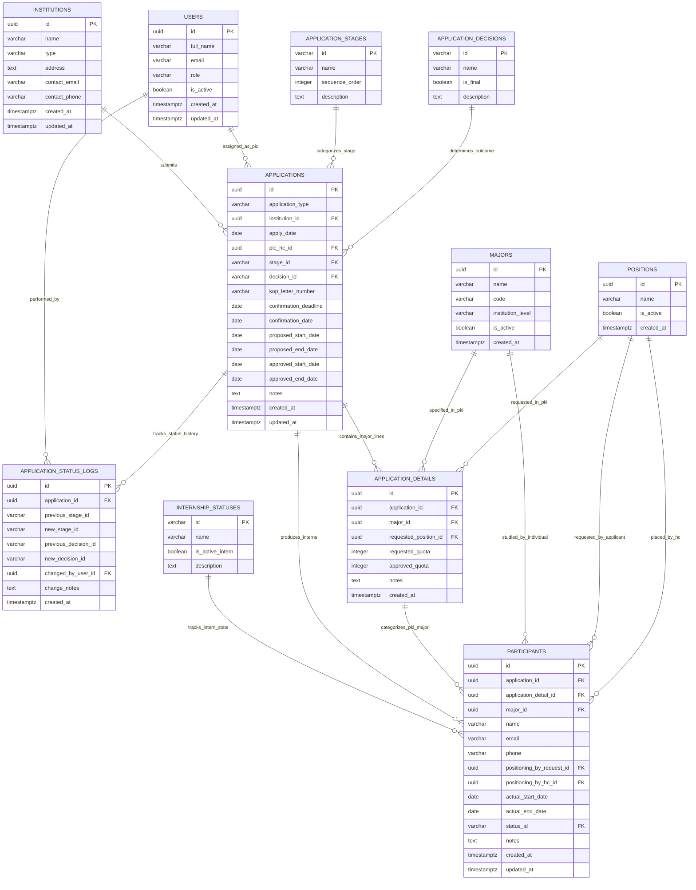

# ERD (Entity Relationship Diagram)
## Sistem Manajemen Pengajuan & Monitoring Magang / PKL REDIGMA

Dokumen ini mendefinisikan rancangan basis data relasional (*Entity Relationship Diagram*) untuk sistem manajemen pengajuan dan pemantauan magang/PKL di Human Capital (HC) REDIGMA. Desain ini diturunkan langsung dari analisis berkas operasional aktual `INPUT_PENGAJUAN_MAGANG.xlsx`, alur bisnis HC, serta kebutuhan tata kelola data yang terintegrasi, ternormalisasi, dan terukur untuk PostgreSQL/Supabase.

Fokus dokumen ini adalah pemodelan data untuk **pengguna internal Human Capital (HC)** yang mengelola operasional magang. Portal publik bukan merupakan kebutuhan MVP saat ini.

---

## 1. Tujuan

Perancangan Entity Relationship Diagram (ERD) ini bertujuan untuk:
1. **Menggantikan Penyimpanan Spreadsheet yang Rentan dan Terduplikasi**: Mentransformasikan lembar kerja `DATABASE_PELAMAR`, `PENGAJUAN PKL`, `DATABASE_SISWA`, dan `MASTER_TABEL` ke dalam arsitektur basis data relasional yang ternormalisasi (minimal Third Normal Form / 3NF).
2. **Menyatukan Jalur Pengajuan (PKL & Magang Mandiri) Tanpa Redundansi Tabel**: Mengakomodasi kebutuhan pendaftaran PKL berbasis institusi (sekolah) dan Magang Mandiri berbasis individu (mahasiswa) dalam entitas transaksi yang kohesif tanpa menciptakan tabel terisolasi.
3. **Menghilangkan Duplikasi Data Pengajuan Multi-Jurusan**: Mengatasi kelemahan spreadsheet aktual di mana sekolah yang mengajukan beberapa jurusan sekaligus (contoh kasus SMK N 2 Magelang dengan 4 jurusan pada nomor KOP surat yang sama) harus dicatat berulang kali pada baris terpisah.
4. **Memisahkan Tiga Domain Status yang Sering Tertukar**: Secara ketat membedakan domain *Tahapan Proses Pengajuan*, *Keputusan Akhir Seleksi*, dan *Status Keaktifan Peserta Magang* guna menjamin akurasi indikator monitoring operasional.
5. **Memisahkan Preferensi Pelamar dan Keputusan Penempatan**: Membedakan secara tegas antara divisi/posisi yang diminati pemohon (*Positioning by Request*) dengan penempatan kerja nyata oleh HC (*Positioning by HC*).
6. **Membangun Akuntabilitas Staf HC**: Menghubungkan peran penanggung jawab penanganan (*PIC Human Capital*) secara langsung ke entitas pengguna internal sistem (`users`), bukan sekadar teks bebas.
7. **Menyediakan Histori Perubahan Status Pengajuan**: Mempertahankan rekam jejak kronologis perpindahan tahapan dan keputusan pengajuan secara sederhana dan proporsional untuk MVP.

---

## 2. Prinsip Perancangan

Perancangan basis data berpegang pada prinsip rekayasa data berikut:

1. **Normalisasi Data & Eliminasi Redundansi**:
   - Menghindari penyimpanan data yang sama di lebih dari satu tempat.
   - Institusi peserta magang (`institutions`) tidak disimpan redundan di entitas `participants`, melainkan diperoleh secara relasional melalui `applications.institution_id`.
   - Informasi jurusan (`majors`) dan posisi permohonan (*Positioning by Request*) untuk peserta PKL diturunkan langsung dari rincian pengajuan (`application_details`).
2. **Generalisasi Entitas Institusi**:
   - Sekolah Menengah Kejuruan (SMK), Universitas/Perguruan Tinggi, Politeknik, Lembaga Pelatihan, maupun Pesantren disatukan dalam entitas `institutions` dengan atribut pembeda tipe lembaga.
   - Pada Magang Mandiri, asal universitas pelamar yang dicatat pada spreadsheet tetap direlasikan ke `institutions`.
3. **Pemisahan Alur PKL vs Magang Mandiri**:
   - **Jalur PKL (Sekolah)**: Menggunakan alur berjenjang:
     $$\text{applications} \longrightarrow \text{application\_details} \longrightarrow \text{participants}$$
     Karena satu surat pengajuan sekolah dapat mencakup beberapa jurusan dan posisi yang diajukan.
   - **Jalur Magang Mandiri (Individu)**: Menggunakan alur langsung:
     $$\text{applications} \longrightarrow \text{participants}$$
     Data pelamar individu dikelola langsung pada entitas `applications` dan `participants` tanpa mewajibkan rekaman `application_details`.
4. **Sumber Tunggal Kuota yang Diajukan (Single Source of Truth)**:
   - Kuota yang diajukan dicatat pada level detail permohonan (`application_details.requested_quota`). Total kuota pada level surat pengajuan dihitung melalui fungsi agregat (`SUM`), bukan disimpan ganda pada tabel `applications`.
5. **Penyederhanaan Master Posisi/Divisi**:
   - Operasional aktual REDIGMA pada spreadsheet tidak membedakan hierarki antara *position*, *division*, dan *department* untuk konteks penempatan magang. Entitas `positions` disederhanakan menjadi master daftar posisi/divisi magang tunggal.
6. **Entitas Peserta Independen Berelasi (*Traceable Participants*)**:
   - Individu yang menjalani magang dicatat dalam entitas `participants`. Data peserta tidak boleh dihapus ketika program berakhir (*soft lifecycle management* melalui status data historis) dan selalu terhubung ke pengajuan asalnya (`application_id`).
7. **Pemisahan Logika Data dan Presentasi UI**:
   - Nilai visual antarmuka (seperti kode warna badge status) tidak disimpan di basis data. Styling merupakan tanggung jawab lapisan frontend.
8. **Penamaan Berstandar Internasional**:
   - Seluruh nama tabel dan kolom menggunakan bahasa Inggris dalam format `snake_case` untuk menjamin keselarasan dengan konvensi PostgreSQL dan Supabase.
9. **Penandaan Ketidakpastian Operasional**:
   - Setiap aspek data yang belum memiliki dasar keputusan mutlak dari tim HC ditandai secara eksplisit sebagai **"Perlu Validasi HC"**.

---

## 3. Daftar Entitas

Sistem membagi entitas basis data ke dalam 3 kelompok utama:

### 3.1. Kelompok Master & Referensi (Reference & Master Entities)
1. **`users`**: Menyimpan identitas akun pengguna internal perusahaan, khususnya staf Human Capital (HC) yang bertindak sebagai PIC penanganan berkas dan pengelola operasional.
2. **`institutions`**: Menyimpan data induk institusi pendidikan asal pelamar/peserta (SMK, Universitas, Institut, Politeknik, Pesantren).
3. **`majors`**: Menyimpan data referensi jurusan atau program keahlian/program studi pendidikan formal.
4. **`positions`**: Menyimpan master data posisi/divisi magang di REDIGMA yang menjadi opsi penempatan peserta magang (mengakomodasi daftar *Divisi/Area* pada spreadsheet).
5. **`application_stages`**: Menyimpan nilai referensi tahapan pemrosesan tiket pengajuan oleh staf HC.
6. **`application_decisions`**: Menyimpan nilai referensi hasil putusan akhir seleksi administratif oleh HC.
7. **`internship_statuses`**: Menyimpan nilai referensi siklus hidup dan keaktifan peserta selama menjalani program di perusahaan.

### 3.2. Kelompok Transaksional Pengajuan & Penempatan (Core Transaction Entities)
8. **`applications`**: Menyimpan berkas pengajuan magang utama, baik berjenis kelompok dari sekolah (`PKL`) maupun perorangan dari mahasiswa (`MAGANG_MANDIRI`).
9. **`application_details`**: Menyimpan rincian jurusan, posisi yang diminati pemohon, serta kuota yang diajukan dalam satu berkas pengajuan (digunakan untuk pengajuan kelompok/PKL multi-jurusan).
10. **`participants`**: Menyimpan data individu setiap siswa/mahasiswa yang menjalani magang/PKL, riwayat penempatan posisi akhir oleh HC, durasi magang aktual, dan status keaktifannya.

### 3.3. Kelompok Histori Status (Status History Entity)
11. **`application_status_logs`**: Menyimpan rekam jejak kronologis perpindahan tahapan dan keputusan akhir setiap pengajuan secara sederhana untuk akuntabilitas internal tim HC (bukan *full audit log* tingkat enterprise).

---

## 4. Relasi Antar Entitas

Kardinalitas dan hubungan antar entitas dirancang sebagai berikut:

| Entitas Asal (Parent) | Kardinalitas | Entitas Tujuan (Child) | Foreign Key pada Child | Aturan Integritas / Keterangan |
| :--- | :---: | :--- | :--- | :--- |
| `institutions` | **1 : N** | `applications` | `applications.institution_id` | Satu institusi dapat mengajukan banyak permohonan magang dari waktu ke waktu. |
| `users` | **1 : N** | `applications` | `applications.pic_hc_id` | Satu staf HC dapat menjadi PIC untuk banyak pengajuan (Nullable saat status awal). |
| `application_stages` | **1 : N** | `applications` | `applications.stage_id` | Satu tahapan proses dapat dimiliki oleh banyak pengajuan. |
| `application_decisions`| **1 : N** | `applications` | `applications.decision_id` | Satu jenis keputusan seleksi dapat dikenakan pada banyak pengajuan. |
| `applications` | **1 : N** | `application_details`| `application_details.application_id` | Satu pengajuan PKL memiliki satu atau banyak detail jurusan (*Cascade Delete*). |
| `majors` | **1 : N** | `application_details`| `application_details.major_id` | Satu jurusan dapat diajukan dalam banyak detail permohonan PKL (Nullable untuk institusi non-kejuruan). |
| `positions` | **1 : N** | `application_details`| `application_details.requested_position_id` | Posisi yang diminati pemohon pada rincian permohonan PKL. |
| `applications` | **1 : N** | `participants` | `participants.application_id` | Satu pengajuan menghasilkan 1 atau N peserta. Relasi tetap 1:N secara skema database baik untuk PKL maupun Magang Mandiri. |
| `application_details` | **1 : N** | `participants` | `participants.application_detail_id`| Mengelompokkan peserta PKL ke dalam rincian jurusan asal (*Nullable* untuk Magang Mandiri). |
| `majors` | **1 : N** | `participants` | `participants.major_id` | Jurusan peserta magang (*Digunakan untuk Magang Mandiri ketika application_detail_id bernilai NULL*). |
| `positions` | **1 : N** | `participants` | `participants.positioning_by_request_id` | Posisi yang diminta oleh peserta (*Digunakan untuk Magang Mandiri ketika application_detail_id bernilai NULL*). |
| `positions` | **1 : N** | `participants` | `participants.positioning_by_hc_id` | Posisi penempatan definitif peserta yang ditetapkan oleh tim HC (Nullable saat belum mulai). |
| `internship_statuses` | **1 : N** | `participants` | `participants.status_id` | Satu status keaktifan dapat dimiliki oleh banyak peserta magang. |
| `applications` | **1 : N** | `application_status_logs` | `application_status_logs.application_id` | Satu pengajuan mencatat riwayat perubahan status dari waktu ke waktu. |
| `users` | **1 : N** | `application_status_logs` | `application_status_logs.changed_by_user_id`| Mencatat staf HC yang melakukan tindakan pembaruan status. |

---

## 5. Mermaid ER Diagram

Diagram berikut menggambarkan skema entitas, atribut utama, *primary key* (PK), *foreign key* (FK), dan kardinalitas relasional:



---

## 6. Penjelasan Entitas

Bagian ini menguraikan struktur rinci setiap tabel, tipe data PostgreSQL, batasan nilai (*constraints*), dan peranan bisnisnya.

### 6.1. `users`
- **Tujuan**: Merepresentasikan akun internal staf Human Capital (HC) yang bertindak sebagai PIC penanganan pengajuan dan operator sistem (mengakomodasi data nama staf pada spreadsheet: Fitri Indriyani, Fajar Ade Dwi Widyastuti, Shofi Alifah Nur Aini). Entitas ini difokuskan murni untuk data operasional internal HC; rincian integrasi autentikasi production dan otorisasi menyeluruh akan dibahas pada dokumen terpisah.
- **Tabel Desain**:
  | Nama Kolom | Tipe Data | Batasan | Keterangan |
  | :--- | :--- | :--- | :--- |
  | `id` | `UUID` | **PK**, Default: `gen_random_uuid()` | Kunci primer identitas unik pengguna internal. |
  | `full_name` | `VARCHAR(150)` | **NOT NULL** | Nama lengkap staf internal HC. |
  | `email` | `VARCHAR(150)` | **NOT NULL, UNIQUE** | Email staf internal untuk korespondensi dan penugasan PIC. |
  | `role` | `VARCHAR(50)` | **NOT NULL, DEFAULT 'hc_staff'** | Peran operasional internal (e.g., `hc_staff`, `hc_lead`). |
  | `is_active` | `BOOLEAN` | **NOT NULL, DEFAULT TRUE** | Flag keaktifan akun staf internal. |
  | `created_at` | `TIMESTAMPTZ` | **NOT NULL, DEFAULT NOW()** | Waktu pencatatan data pengguna. |
  | `updated_at` | `TIMESTAMPTZ` | **NOT NULL, DEFAULT NOW()** | Waktu pemutakhiran data profil. |

---

### 6.2. `institutions`
- **Tujuan**: Menampung identitas induk seluruh lembaga pendidikan pemohon (SMK, Universitas, Politeknik, maupun Yayasan/Pesantren) agar tidak terjadi redundansi penulisan nama institusi di berbagai tempat.
- **Tabel Desain**:
  | Nama Kolom | Tipe Data | Batasan | Keterangan |
  | :--- | :--- | :--- | :--- |
  | `id` | `UUID` | **PK**, Default: `gen_random_uuid()` | Kunci primer institusi. |
  | `name` | `VARCHAR(200)` | **NOT NULL** | Nama resmi institusi (e.g., 'SMK N Pringsurat', 'Pesantren Sintesa', 'SMK N 2 Magelang'). |
  | `type` | `VARCHAR(50)` | **NOT NULL** | Kategori institusi: `SMK`, `UNIVERSITAS`, `POLITEKNIK`, `PESANTREN`, `LAINNYA`. |
  | `address` | `TEXT` | **NULLABLE** | Alamat fisik lembaga pendidikan (*Perlu Validasi HC apakah diperlukan di MVP*). |
  | `contact_email` | `VARCHAR(150)` | **NULLABLE** | Surel resmi narahubung institusi atau BKK/Humas. |
  | `contact_phone` | `VARCHAR(50)` | **NULLABLE** | Nomor telepon/WhatsApp narahubung institusi. |
  | `created_at` | `TIMESTAMPTZ` | **NOT NULL, DEFAULT NOW()** | Waktu data institusi didaftarkan. |
  | `updated_at` | `TIMESTAMPTZ` | **NOT NULL, DEFAULT NOW()** | Waktu data institusi diperbarui. |

---

### 6.3. `majors`
- **Tujuan**: Menyediakan master daftar jurusan terstandardisasi guna mencegah variasi singkatan manual (seperti kerancuan antara 'TJKT', 'Teknik Jaringan Komputer', dan 'TKJ').
- **Tabel Desain**:
  | Nama Kolom | Tipe Data | Batasan | Keterangan |
  | :--- | :--- | :--- | :--- |
  | `id` | `UUID` | **PK**, Default: `gen_random_uuid()` | Kunci primer jurusan. |
  | `name` | `VARCHAR(150)` | **NOT NULL** | Nama lengkap jurusan (e.g., 'Teknik Jaringan Komputer & Telekomunikasi (TJKT)', 'Pengembangan Perangkat Lunak & Gim (PPLG)'). |
  | `code` | `VARCHAR(30)` | **NULLABLE** | Kode singkatan jurusan (e.g., 'TJKT', 'PPLG', 'AKL', 'MPLB', 'DKV'). |
  | `institution_level`| `VARCHAR(30)` | **NULLABLE** | Klasifikasi tingkat jenjang: `SMK`, `DIPLOMA`, `SARJANA`, `SEMUA`. |
  | `is_active` | `BOOLEAN` | **NOT NULL, DEFAULT TRUE** | Status keaktifan jurusan di dalam sistem seleksi. |
  | `created_at` | `TIMESTAMPTZ` | **NOT NULL, DEFAULT NOW()** | Waktu master jurusan dibuat. |

---

### 6.4. `positions` (Master Posisi/Divisi Magang)
- **Tujuan**: Menstandarkan penamaan posisi/divisi magang di REDIGMA. Karena pada operasional aktual di spreadsheet tidak terdapat pembedaan fungsional antara *position*, *division*, dan *department* untuk konteks penempatan magang, entitas ini dirancang sederhana sebagai master daftar posisi/divisi magang tunggal (mengakomodasi 33+ opsi penempatan pada spreadsheet seperti *Core Management, Revenue Commercial Lead, Human Capital, CS & CRM, Advertiser TikTok, Advertiser Shopee, CC Soscom, Editor MP, MCN, Data & IT*, dll). Kolom hierarki seperti `department_area` ditiadakan untuk MVP.
- **Tabel Desain**:
  | Nama Kolom | Tipe Data | Batasan | Keterangan |
  | :--- | :--- | :--- | :--- |
  | `id` | `UUID` | **PK**, Default: `gen_random_uuid()` | Kunci primer posisi/divisi magang. |
  | `name` | `VARCHAR(100)` | **NOT NULL, UNIQUE** | Nama resmi posisi/divisi magang di REDIGMA. |
  | `is_active` | `BOOLEAN` | **NOT NULL, DEFAULT TRUE** | Flag apakah posisi/divisi ini aktif membuka penempatan. |
  | `created_at` | `TIMESTAMPTZ` | **NOT NULL, DEFAULT NOW()** | Waktu data posisi didaftarkan. |

---

### 6.5. `application_stages` (Reference Table: Tahapan Proses)
- **Tujuan**: Mengatur tahapan pemrosesan berkas pengajuan oleh staf HC secara terstandar. Berdasarkan spreadsheet aktual, nilai awalnya adalah `Belum Ditanggapi` dan `Sudah Ditanggapi`.
- **Tabel Desain**:
  | Nama Kolom | Tipe Data | Batasan | Keterangan |
  | :--- | :--- | :--- | :--- |
  | `id` | `VARCHAR(50)` | **PK** | Kode unik identifier (e.g., `belum_ditanggapi`, `sudah_ditanggapi`). |
  | `name` | `VARCHAR(100)` | **NOT NULL** | Label teks tahapan proses (e.g., 'Belum Ditanggapi', 'Sudah Ditanggapi'). |
  | `sequence_order` | `INTEGER` | **NOT NULL** | Urutan alur proses (1, 2, dst.). |
  | `description` | `TEXT` | **NULLABLE** | Penjelasan tahapan operasional. |

---

### 6.6. `application_decisions` (Reference Table: Keputusan Akhir)
- **Tujuan**: Menetapkan hasil seleksi kelayakan penerimaan pengajuan secara terpisah dari tahap proses penanganannya. Mengacu pada master spreadsheet: `Dalam Proses`, `Diterima`, dan `Ditolak`.
- **Tabel Desain**:
  | Nama Kolom | Tipe Data | Batasan | Keterangan |
  | :--- | :--- | :--- | :--- |
  | `id` | `VARCHAR(50)` | **PK** | Kode unik identifier (e.g., `dalam_proses`, `diterima`, `ditolak`). |
  | `name` | `VARCHAR(100)` | **NOT NULL** | Label teks keputusan (e.g., 'Dalam Proses', 'Diterima', 'Ditolak'). |
  | `is_final` | `BOOLEAN` | **NOT NULL, DEFAULT FALSE** | Indikator keputusan akhir (TRUE jika `diterima` atau `ditolak`). |
  | `description` | `TEXT` | **NULLABLE** | Keterangan logis status keputusan. |

---

### 6.7. `internship_statuses` (Reference Table: Status Magang Peserta)
- **Tujuan**: Mengatur status keaktifan peserta di lapangan secara *real-time*. Diambil dari spreadsheet: `Belum Mulai`, `Sedang Magang`, `Sudah Selesai`, `Mengundurkan Diri`.
- **Tabel Desain**:
  | Nama Kolom | Tipe Data | Batasan | Keterangan |
  | :--- | :--- | :--- | :--- |
  | `id` | `VARCHAR(50)` | **PK** | Kode unik identifier (e.g., `belum_mulai`, `sedang_magang`, `sudah_selesai`, `mengundurkan_diri`). |
  | `name` | `VARCHAR(100)` | **NOT NULL** | Label status keaktifan peserta. |
  | `is_active_intern` | `BOOLEAN` | **NOT NULL, DEFAULT FALSE** | TRUE khusus status `sedang_magang` untuk penyaringan instan peserta aktif di pemantauan. |
  | `description` | `TEXT` | **NULLABLE** | Deskripsi status. |

---

### 6.8. `applications` (Entitas Utama Berkas Pengajuan)
- **Tujuan**: Menyimpan berkas pengajuan magang utama yang masuk ke REDIGMA, baik berkas kelompok sekolah (PKL) maupun pendaftaran perorangan mahasiswa (Magang Mandiri).
- **Tabel Desain**:
  | Nama Kolom | Tipe Data | Batasan | Keterangan |
  | :--- | :--- | :--- | :--- |
  | `id` | `UUID` | **PK**, Default: `gen_random_uuid()` | Kunci primer pengajuan. |
  | `application_type` | `VARCHAR(30)` | **NOT NULL, CHECK (application_type IN ('PKL', 'MAGANG_MANDIRI'))** | Jenis jalur pengajuan program. |
  | `institution_id` | `UUID` | **FK -> institutions(id), NOT NULL** | Institusi asal pemohon (sekolah PKL atau universitas asal pelamar mandiri). |
  | `apply_date` | `DATE` | **NOT NULL** | Tanggal surat permohonan masuk atau pelamar apply. |
  | `pic_hc_id` | `UUID` | **FK -> users(id), NULLABLE** | Staf HC yang ditugaskan menangani berkas (kosong di awal sesuai panduan). |
  | `stage_id` | `VARCHAR(50)` | **FK -> application_stages(id), NOT NULL, DEFAULT 'belum_ditanggapi'** | Status tahapan penanganan saat ini. |
  | `decision_id` | `VARCHAR(50)` | **FK -> application_decisions(id), NOT NULL, DEFAULT 'dalam_proses'** | Putusan akhir seleksi administrasi. |
  | `kop_letter_number` | `VARCHAR(100)` | **NULLABLE** | Nomor KOP surat permohonan PKL sekolah. **Tidak di-set UNIQUE** karena satu surat dapat diajukan untuk multi-jurusan (*Perlu Validasi HC*). |
  | `confirmation_deadline` | `DATE` | **NULLABLE** | Batas waktu respon/konfirmasi ke pihak pemohon (khusus PKL). |
  | `confirmation_date` | `DATE` | **NULLABLE** | Tanggal riil staf HC mengirimkan konfirmasi/balasan ke sekolah. |
  | `proposed_start_date` | `DATE` | **NULLABLE** | Tanggal rencana mulai magang yang diajukan pemohon. |
  | `proposed_end_date` | `DATE` | **NULLABLE** | Tanggal rencana selesai magang yang diajukan pemohon. |
  | `approved_start_date` | `DATE` | **NULLABLE** | Tanggal mulai magang yang disetujui resmi oleh HC. |
  | `approved_end_date` | `DATE` | **NULLABLE** | Tanggal selesai magang yang disetujui resmi oleh HC. |
  | `notes` | `TEXT` | **NULLABLE** | Catatan administratif tambahan dari tim HC. |
  | `created_at` | `TIMESTAMPTZ` | **NOT NULL, DEFAULT NOW()** | Waktu pembuatan tiket pengajuan di sistem. |
  | `updated_at` | `TIMESTAMPTZ` | **NOT NULL, DEFAULT NOW()** | Waktu pembaruan tiket terakhir. |

*Catatan Kuota*: Total kuota pengajuan tidak disimpan fisik di tabel ini guna menghindari redundansi data. Sumber utama kuota adalah `application_details.requested_quota`.

---

### 6.9. `application_details` (Detail Jurusan & Permohonan Posisi PKL)
- **Tujuan**: Menghilangkan redundansi spreadsheet aktual pada kasus satu pengajuan PKL yang mengajukan beberapa jurusan sekaligus. Entitas ini memungkinkan 1 berkas pengajuan memiliki banyak baris rincian jurusan, posisi yang diminati pemohon, dan kuota yang diajukan.
- **Tabel Desain**:
  | Nama Kolom | Tipe Data | Batasan | Keterangan |
  | :--- | :--- | :--- | :--- |
  | `id` | `UUID` | **PK**, Default: `gen_random_uuid()` | Kunci primer detail pengajuan. |
  | `application_id` | `UUID` | **FK -> applications(id) ON DELETE CASCADE, NOT NULL** | Relasi ke berkas pengajuan induk PKL. |
  | `major_id` | `UUID` | **FK -> majors(id), NULLABLE** | Jurusan yang diajukan (Nullable jika pemohon tidak berbasis kejuruan formal/pesantren). |
  | `requested_position_id` | `UUID` | **FK -> positions(id), NULLABLE** | Posisi/divisi yang diminati oleh pemohon untuk jurusan ini (*Positioning by Request*). |
  | `requested_quota` | `INTEGER` | **NULLABLE** | **Sumber utama kuota yang diajukan** untuk rincian jurusan ini (sesuai kolom spreadsheet *Jumlah siswa yang akan PKL*). |
  | `approved_quota` | `INTEGER` | **NULLABLE** | Kuota yang disetujui oleh HC untuk jurusan ini (**Perlu Validasi HC**: tidak ada di spreadsheet, disediakan sebagai kebutuhan pengembangan sistem). |
  | `notes` | `TEXT` | **NULLABLE** | Keterangan khusus per jurusan/posisi. |
  | `created_at` | `TIMESTAMPTZ` | **NOT NULL, DEFAULT NOW()** | Waktu detail permohonan dibuat. |

---

### 6.10. `participants` (Data Individu Peserta Magang)
- **Tujuan**: Menyimpan data individu manusia yang menjalani magang/PKL (merefleksikan sheet `DATABASE_SISWA` untuk siswa PKL dan data pelamar pada `DATABASE_PELAMAR` yang telah diterima).
- **Penanganan Redundansi**:
  - Kolom `institution_id` **dihapus** dari tabel ini karena institusi peserta selalu dapat diturunkan melalui relasi: `participants` $\rightarrow$ `applications` $\rightarrow$ `institutions`.
  - Kolom `major_id`: Untuk peserta PKL, jurusan diperoleh melalui relasi ke `application_details.major_id`. Kolom `participants.major_id` diisi khusus untuk peserta jalur **Magang Mandiri** di mana `application_detail_id` bernilai `NULL`.
  - Kolom `positioning_by_request_id`: Untuk peserta PKL, posisi request diperoleh dari `application_details.requested_position_id`. Kolom `participants.positioning_by_request_id` diisi khusus untuk pelamar jalur **Magang Mandiri**.
- **Tabel Desain**:
  | Nama Kolom | Tipe Data | Batasan | Keterangan |
  | :--- | :--- | :--- | :--- |
  | `id` | `UUID` | **PK**, Default: `gen_random_uuid()` | Kunci primer data peserta magang. |
  | `application_id` | `UUID` | **FK -> applications(id), NOT NULL** | Menelusuri peserta kembali ke pengajuan asalnya (*traceability*). Hubungan tetap 1:N secara skema tanpa batasan unik. |
  | `application_detail_id`| `UUID` | **FK -> application_details(id), NULLABLE** | Menunjukkan rincian jurusan asal untuk peserta PKL. Bernilai **NULL** untuk Magang Mandiri. |
  | `major_id` | `UUID` | **FK -> majors(id), NULLABLE** | Jurusan peserta. **Digunakan khusus untuk Magang Mandiri** (saat `application_detail_id` bernilai NULL). |
  | `name` | `VARCHAR(150)` | **NOT NULL** | Nama lengkap siswa atau mahasiswa magang. |
  | `email` | `VARCHAR(150)` | **NULLABLE** | Surel pribadi peserta magang. |
  | `phone` | `VARCHAR(50)` | **NULLABLE** | Nomor telepon/WhatsApp peserta. |
  | `positioning_by_request_id` | `UUID` | **FK -> positions(id), NULLABLE** | Posisi yang diminati pelamar. **Digunakan khusus untuk Magang Mandiri** (saat `application_detail_id` bernilai NULL). |
  | `positioning_by_hc_id` | `UUID` | **FK -> positions(id), NULLABLE** | Posisi/divisi penempatan kerja nyata hasil keputusan HC (e.g., *Human Capital, CC Soscom, Editor MP, MCN*). |
  | `actual_start_date` | `DATE` | **NULLABLE** | Tanggal riil peserta mulai aktif magang di REDIGMA. Bersifat *nullable* menyesuaikan siklus hidup peserta. |
  | `actual_end_date` | `DATE` | **NULLABLE** | Tanggal riil berakhirnya masa magang peserta. Bersifat *nullable* menyesuaikan siklus hidup peserta. |
  | `status_id` | `VARCHAR(50)` | **FK -> internship_statuses(id), NOT NULL, DEFAULT 'belum_mulai'** | Status keaktifan operasional peserta. |
  | `notes` | `TEXT` | **NULLABLE** | **Catatan administratif terkait peserta** (bukan evaluasi kinerja atau appraisal). |
  | `created_at` | `TIMESTAMPTZ` | **NOT NULL, DEFAULT NOW()** | Waktu pencatatan peserta. |
  | `updated_at` | `TIMESTAMPTZ` | **NOT NULL, DEFAULT NOW()** | Waktu pemutakhiran data peserta. |

---

### 6.11. `application_status_logs` (Histori Perubahan Status Pengajuan)
- **Tujuan**: Menyediakan mekanisme pencatatan histori perubahan status pengajuan yang sederhana untuk MVP. Tabel ini **bukan merupakan full audit log system**, melainkan hanya mencatat:
  - Perubahan tahapan proses (`stage_id`)
  - Perubahan keputusan akhir (`decision_id`)
  - Pengguna internal HC yang melakukan tindakan
  - Waktu perubahan data
  - Catatan administratif singkat terkait perubahan
- **Tabel Desain**:
  | Nama Kolom | Tipe Data | Batasan | Keterangan |
  | :--- | :--- | :--- | :--- |
  | `id` | `UUID` | **PK**, Default: `gen_random_uuid()` | Kunci primer histori status. |
  | `application_id` | `UUID` | **FK -> applications(id) ON DELETE CASCADE, NOT NULL** | Relasi ke berkas pengajuan yang statusnya berubah. |
  | `previous_stage_id` | `VARCHAR(50)` | **NULLABLE** | Tahapan proses sebelum perubahan. |
  | `new_stage_id` | `VARCHAR(50)` | **NULLABLE** | Tahapan proses sesudah perubahan. |
  | `previous_decision_id`| `VARCHAR(50)` | **NULLABLE** | Keputusan akhir sebelum perubahan. |
  | `new_decision_id` | `VARCHAR(50)` | **NULLABLE** | Keputusan akhir sesudah perubahan. |
  | `changed_by_user_id` | `UUID` | **FK -> users(id), NULLABLE** | Akun staf HC yang melakukan pembaruan status. |
  | `change_notes` | `TEXT` | **NULLABLE** | Alasan atau catatan administratif pembaruan status. |
  | `created_at` | `TIMESTAMPTZ` | **NOT NULL, DEFAULT NOW()** | Stempel waktu terjadinya perubahan data. |

---

## 7. Aturan Data (Business & Data Integrity Rules)

Berdasarkan analisis spreadsheet dan alur operasional HC, aturan integritas data dirumuskan sebagai berikut:

### 7.1. Alur Relasi PKL vs Magang Mandiri
1. **Jalur PKL (Sekolah)**:
   - Satu berkas `applications` mewakili satu surat pengajuan resmi sekolah.
   - Menggunakan entitas `application_details` karena satu surat sekolah dapat mencakup rincian beberapa jurusan dengan kuota dan preferensi posisi masing-masing.
   - Peserta PKL di entitas `participants` memiliki relasi `application_detail_id` yang valid untuk mengaitkan siswa dengan jurusan pengajuannya.
   - Institusi siswa diperoleh via `applications.institution_id`.
   - Jurusan siswa diperoleh via `application_details.major_id`.
   - Preferensi posisi siswa diperoleh via `application_details.requested_position_id`.
2. **Jalur Magang Mandiri (Individu)**:
   - Satu berkas `applications` mewakili satu permohonan pelamar individu.
   - Asal universitas pelamar dicatat pada `applications.institution_id` (karena universitas adalah institusi).
   - Pengajuan Magang Mandiri **tidak mewajibkan rekaman `application_details`**.
   - Data pelamar individu langsung dicatat pada entitas `participants` dengan `application_id` yang mereferensikan pengajuannya, dan `application_detail_id` bernilai `NULL`.
   - Karena `application_detail_id` bernilai NULL, maka jurusan pelamar disimpan langsung pada `participants.major_id`, dan preferensi posisi pelamar disimpan pada `participants.positioning_by_request_id`.
   - Relasi skema antara `applications` dan `participants` tetap **1 : N** tanpa batasan `UNIQUE` buatan pada database, meskipun secara proses bisnis satu pengajuan mandiri biasanya menghasilkan satu peserta.

### 7.2. Kuota Pengajuan Tunggal (Single Source of Truth)
1. **Sumber Data Kuota**: Kuota yang diajukan pemohon dikelola murni pada kolom `application_details.requested_quota`.
2. **Kalkulasi Total**: Total kuota siswa untuk satu berkas pengajuan PKL tidak disimpan pada tabel `applications`, melainkan dihitung secara dinamis melalui agregasi:
   ```sql
   SELECT application_id, SUM(requested_quota) AS total_requested_quota
   FROM application_details
   GROUP BY application_id;
   ```
3. **Status Nilai**: Keputusan menetapkan kuota pada level detail ini ditandai sebagai **Perlu Validasi HC** untuk mengonfirmasi apakah sekolah selalu merinci kuota per jurusan atau ada surat yang hanya mencantumkan kuota total.

### 7.3. Siklus Hidup Peserta dan Tanggal Aktual (Lifecycle Dates)
1. **Sifat Fleksibel Tanggal Aktual**: Kolom `participants.actual_start_date` dan `participants.actual_end_date` bersifat **NULLABLE**.
2. **Keterkaitan Siklus Hidup**:
   - Staf HC dapat mengisi tanggal aktual sesuai kondisi riil pelaksanaan peserta di kantor.
   - Saat peserta baru didaftarkan atau berstatus `belum_mulai`, tanggal aktual dapat dibiarkan kosong (`NULL`) atau diisi sementara mengacu pada tanggal pengajuan yang disetujui.
   - Pengisian tanggal aktual **bukan merupakan syarat wajib otomatis** pada saat perubahan status magang untuk lingkup MVP.
3. **Batasan Logis Rentang Tanggal**: Jika kedua tanggal terisi, sistem memberlakukan batasan bahwa tanggal selesai harus lebih besar atau sama dengan tanggal mulai (`CHECK (actual_end_date >= actual_start_date)`).

### 7.4. Pemisahan Positioning (Request vs HC Placement) & Opsi Multi-Position
1. **`Positioning By Request`**:
   - Merepresentasikan minat atau preferensi divisi yang diajukan oleh pemohon pada permohonan awal.
   - Pada PKL, tersimpan di `application_details.requested_position_id`.
   - Pada Magang Mandiri, tersimpan di `participants.positioning_by_request_id` (karena tidak melalui detail).
   - Relasi mengarah ke 1 id posisi terdaftar pada tabel `positions`.
2. **`Positioning By HC`**:
   - Merepresentasikan divisi atau peran penugasan definitif yang diputuskan oleh tim Human Capital REDIGMA berdasarkan kebutuhan operasional perusahaan (e.g., *Human Capital, CC Soscom, Editor MP, MCN, Data & IT*).
   - Disimpan murni pada `participants.positioning_by_hc_id`.
   - Nilai ini berdiri sendiri dan dapat berbeda dari preferensi yang diminta (seperti tampak pada data spreadsheet aktual).
3. **Isu Multi-Position Request**:
   - Pada spreadsheet aktual terdapat catatan gabungan seperti `"CC Tiktok, CC Sales Support, CC Soscom"`.
   - Hal ini ditandai sebagai **Perlu Validasi HC**.
   - *Opsi Desain Lanjutan*: Jika HC memvalidasi bahwa sekolah/pelamar wajib dapat memilih lebih dari satu preferensi posisi, opsi desain lanjutan adalah menyediakan tabel relasi perantara (*junction table*) `application_detail_requested_positions (application_detail_id, position_id, priority_order)`. Hal ini tidak dijadikan constraint pada MVP saat ini.

### 7.5. Pemisahan Domain Status & Alur Logis
1. **Tahapan Proses (`application_stages`)**:
   - `belum_ditanggapi`: Nilai awal saat berkas baru diterima sistem. Kolom `pic_hc_id` dapat bernilai `NULL`.
   - `sudah_ditanggapi`: Diperbarui ketika staf HC mulai memproses berkas atau menghubungi pihak pemohon. Saat status ini dipilih, kolom `pic_hc_id` **wajib diisi**.
2. **Keputusan Akhir (`application_decisions`)**:
   - `dalam_proses`: Nilai awal selama berkas masih ditinjau.
   - `diterima`: Menandakan pengajuan disetujui. Pengisian tanggal periode magang (`approved_start_date`, `approved_end_date`) menjadi relevan.
   - `ditolak`: Menandakan permohonan magang tidak dapat diakomodasi.
3. **Status Keaktifan Peserta (`internship_statuses`)**:
   - `belum_mulai`: Ditetapkan ketika pengajuan diterima, tetapi peserta belum aktif bertugas.
   - `sedang_magang`: Ditetapkan saat peserta telah aktif bertugas di kantor.
   - `sudah_selesai`: Ditetapkan ketika masa program peserta telah berakhir.
   - `mengundurkan_diri`: Ditetapkan bila peserta membatalkan keikutsertaan (seperti kasus siswa SMK Muhammadiyah Mungkid pada spreadsheet).
4. **Prinsip Non-Destruktif Data**: Data peserta dengan status `sudah_selesai` atau `mengundurkan_diri` **dilarang dihapus** dari basis data guna menjaga integritas riwayat institusi dan arsip verifikasi administratif.

---

## 8. Hal yang Perlu Validasi HC

Berdasarkan analisis perbandingan antara spreadsheet aktual dengan perancangan basis data relasional, poin-poin berikut belum dapat dipastikan secara mutlak dari berkas dan membutuhkan konfirmasi lanjutan dari pihak Human Capital REDIGMA:

1. **Granularitas Kuota Siswa PKL (Level Pengajuan vs Level Jurusan)**:
   - *Temuan Spreadsheet*: SMK N Pringsurat merinci kuota per jurusan (4 TJKT, 3 DKV). Namun SMK Muhammadiyah Mungkid mencatat kuota di baris pertama saja, sedangkan SMK N 2 Magelang mengosongkan kolom kuota.
   - *Status*: **Perlu Validasi HC**. Keputusan desain saat ini menetapkan kuota pada `application_details.requested_quota` sebagai sumber utama, dan menghitung total pengajuan secara agregasi. Perlu divalidasi apakah sekolah selalu memberikan rincian per jurusan atau ada surat yang hanya menyebut kuota total sekolah.
2. **Kebutuhan Kolom Kuota Disetujui (`approved_quota`)**:
   - *Temuan Spreadsheet*: Spreadsheet hanya mencatat *Jumlah siswa yang akan PKL* (kuota permohonan sekolah); tidak ada kolom kuota persetujuan HC.
   - *Status*: **Perlu Validasi HC** apakah sistem perlu mencatat kuota yang disetujui secara eksplisit per jurusan (`approved_quota`), ataukah jumlah yang disetujui cukup dihitung dari jumlah siswa yang didaftarkan ke tabel peserta.
3. **Penanganan Permohonan Multi-Posisi**:
   - *Temuan Spreadsheet*: Beberapa sekolah mengisi pilihan posisi gabungan (contoh: `"CC Tiktok, CC Sales Support, CC Soscom"`).
   - *Status*: **Perlu Validasi HC** apakah sekolah memang diperbolehkan memilih beberapa posisi prioritas sekaligus, atau ke depannya sistem membatasi 1 pilihan posisi per jurusan. Jika multi-posisi wajib didukung, akan diimplementasikan tabel relasi perantara (*junction table*) pada fase lanjutan.
4. **Keunikan dan Format Nomor KOP Surat PKL**:
   - *Temuan Spreadsheet*: Satu nomor KOP surat (misal `B/400.14.5.4/2338/2026`) muncul berulang di 4 baris karena memiliki 4 jurusan.
   - *Status*: **Perlu Validasi HC** apakah nomor KOP surat selalu unik untuk setiap berkas pengajuan masuk sekolah, ataukah sekolah dapat menggunakan nomor surat yang sama untuk periode permohonan yang berbeda. Sementara ini, kolom `kop_letter_number` tidak dipasangi batasan unik (`UNIQUE`).
5. **Mekanisme Pelamar Magang Mandiri yang Belum Diterima / Ditolak**:
   - *Temuan Spreadsheet*: Sheet `DATABASE_PELAMAR` mencatat identitas pelamar langsung sejak tahap pendaftaran awal.
   - *Status*: **Perlu Validasi HC** apakah data pelamar Magang Mandiri yang masih berstatus 'Dalam Proses' atau 'Ditolak' perlu dibuatkan rekaman di tabel `participants` sejak awal apply, atau cukup dicatat di level pengajuan hingga berstatus diterima.
6. **Mekanisme Otomasi Pemindahan Status Peserta Berdasarkan Tanggal**:
   - *Temuan Spreadsheet*: Status siswa di sheet `DATABASE_SISWA` bergantung pada formula manual dari sheet pengajuan.
   - *Status*: **Perlu Validasi HC** apakah status keaktifan (`sedang_magang` menjadi `sudah_selesai`) ingin diubah otomatis oleh sistem saat tanggal selesai magang terlewati, atau tetap membutuhkan tindakan penutupan manual oleh staf HC.
7. **Kriteria Penugasan dan Batasan Akses PIC Human Capital**:
   - *Temuan Spreadsheet*: Terdapat kolom `PIC Human Capital` dengan nama staf tertentu (Fitri Indriyani).
   - *Status*: **Perlu Validasi HC** mengenai alur kerja PIC: apakah satu pengajuan dapat dialihkan ke PIC lain, dan bagaimana pembagian hak akses antar staf HC terhadap berkas pengajuan.

---

## 9. Catatan untuk Implementasi Supabase

Sebagai pedoman persiapan teknis internal tim pengembang (tanpa mendahului proses migrasi skema fisik atau pembuatan kode):

1. **Fokus Pengguna Internal HC**:
   - Basis data dirancang murni untuk mendukung operasional internal tim Human Capital REDIGMA.
   - Tidak ada kebutuhan akun publik atau portal sekolah pada lingkup MVP. Akses ke basis data dikelola terpusat untuk pengguna internal HC.
2. **Representasi Pengguna Internal**:
   - Tabel `public.users` merepresentasikan staf internal yang bertugas sebagai PIC dan operator sistem.
   - Detail integrasi otentikasi pengguna dan arsitektur otorisasi (RBAC) menyeluruh akan dibahas secara terpisah pada dokumen arsitektur autentikasi.
3. **Indeks Performa (Performance Indexing)**:
   - Kolom yang sering dijadikan filter dalam pencarian dan pemantauan internal disarankan memiliki indeks B-Tree:
     - `applications(application_type)`
     - `applications(stage_id)`
     - `applications(decision_id)`
     - `applications(apply_date)`
     - `participants(status_id)`
     - `participants(actual_start_date, actual_end_date)`
4. **Pencegahan Redundansi Kolom Waktu**:
   - Kolom `Bulan Apply` dari spreadsheet tidak dibuat sebagai kolom fisik terpisah, melainkan dihasilkan melalui ekspresi SQL:
     ```sql
     EXTRACT(MONTH FROM apply_date) AS apply_month
     ```
5. **Integritas Penghapusan (*Referential Integrity*)**:
   - Relasi antara `applications` dan `application_details` menggunakan aturan `ON DELETE CASCADE`.
   - Relasi antara `institutions`, `majors`, dan `positions` ke data transaksi menggunakan aturan `ON DELETE RESTRICT` untuk menjaga keutuhan riwayat data institusi dan peserta lampau.
